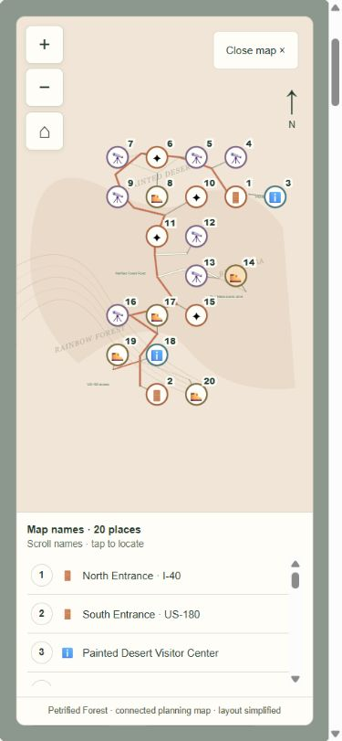
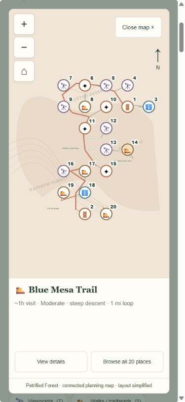
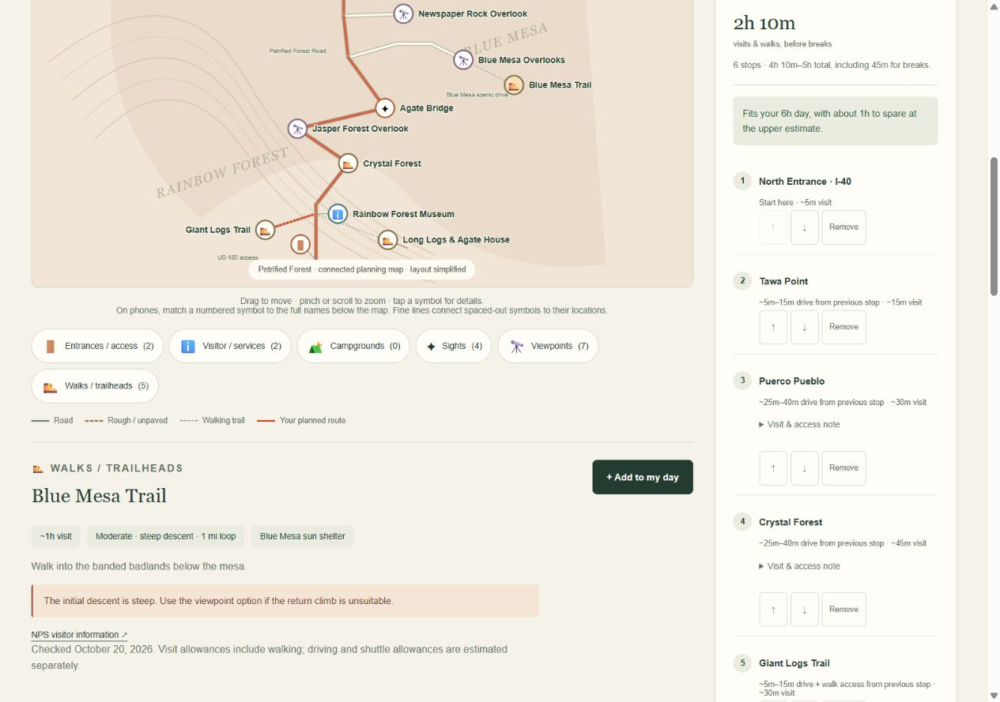
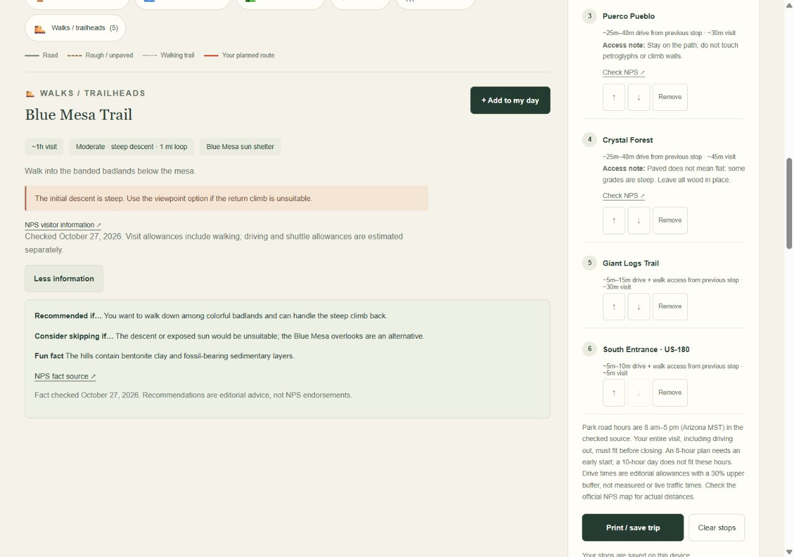

# One-time rubric research and codex comparison — October 29, 2026

The user requested this review **once today**, replacing the original weekly request. No recurring automation was created. Screenshot comparison is **last week's codex versus this week's codex**, not muse versus codex.

## Exact versions

- Before: [e222391](https://github.com/stellaruoyu/national-parks/commit/e2223916be1b726bcdcccdd626dec124173fdb68), saved October 20, 2026. This was the latest codex revision available by the end of October 22 (one week before the review date); there was no October 22 commit.
- After: [ff16778](https://github.com/stellaruoyu/national-parks/commit/ff16778a2307a5ff448c108c0c0e6f5e3d46a4a5), saved October 27, 2026 and still the codex head when this review began October 29.
- [Exact code comparison](https://github.com/stellaruoyu/national-parks/compare/e2223916be1b726bcdcccdd626dec124173fdb68...ff16778a2307a5ff448c108c0c0e6f5e3d46a4a5).

Both versions were rendered from their saved Git content through a temporary local preview, without checking out another branch. Images were captured today; they are reconstructions of the saved versions, not photographs taken last week. The same Petrified Forest / Blue Mesa selection was used to avoid comparing different parks. No application code was changed for this review.

## What changed in codex?

| Item | Before | After | Visitor benefit |
|---|---|---|---|
| Park catalog | Four parks, 107 places | Six parks, 145 places; Sequoia and Kings Canyon added | More connected park choices in the same website. |
| Phone identification | Numbered symbols matched to a visible name list | Selected full name, time/effort or status inside the map; list remains optional | No separate number lookup is required. |
| Optional detail | No More information section | Recommendations, reasons to skip, and individually linked facts | Visitors choose how much detail to read. |
| Planned-stop access notes | Folded behind an access-note summary | Important notes stay visible | Essential information does not depend on expanding extra details. |
| Park location | No nearby-town subtitle | Sourced City, State subtitle | Clearer orientation before choosing an approach. |
| Condition snapshot | October 19/20 checks | October 27 checks, with several status notes refreshed | More recent snapshot; still not live or a fresh October 29 verification. |

The underlying Petrified Forest road layout and 20 marked places are largely unchanged. This report does not present unchanged geometry as a new improvement.

## Screenshot comparison

Phone pair: **390 × 844 browser viewport setting**, expanded whole-park view, Blue Mesa Trail selected. The browser exported each image at 375 × 811 pixels; both exports have matching dimensions. Before shows the numbered list; after shows the full selected name. Both retain the same connected map.

| Before | After |
|---|---|
|  |  |

Desktop pair: **1280 × 900 browser viewport setting**, Blue Mesa Trail details. Both image exports are 1265 × 889 pixels. Before has basic visit/access information; after has More information expanded. Scroll positions differ because the new detail section is longer; this pair illustrates content and behavior, not a pixel-aligned image diff. Access notes in the planner are folded before and visible after.

| Before | After |
|---|---|
|  |  |

## Proposed rubric update

Read [Rubric 4 proposal](../../RUBRIC-4-PROPOSAL.md). **Rubric 3 remains active until the user approves a replacement.** The proposal keeps four categories at five points each while adding explicit date/group fit, whole-trip timing, practical arrival needs, backup choices, and a tested shareable offline handoff. It preserves connected maps and More information behavior.

The proposal is based on Tripadvisor and Google trip-planning research, with sources and the old/new comparison in that file. This is not an implementation request or an approval of those additions.

## Scores and honest limits

The existing REVIEW.md records the current version's author self-assessment of **20/20 per park under Rubric 3**. That is a historical assessment, not a new independent grade, and not a score under the proposed Rubric 4. This one-time task does not repeat the full factual, physical-device, or offline audit needed to issue new comprehensive grades. The old version predates Rubric 3 and lacks its optional recommendation/fact sections; it should not be retrospectively described as having passed that rubric.

Observed gaps against the proposed stricter checks include no actual visit-date/start-time scheduler and no demonstrated offline or companion handoff test. Existing break/drive ranges and print controls are useful foundations, but their presence alone does not prove these new checks pass.

One honest limitation per current park: Joshua Tree's overview cannot show every full name simultaneously; Death Valley's remote-road conditions can invalidate static travel allowances; Petrified Forest's geometry is simplified; Yosemite parking/shuttle queues are unpredictable; Sequoia omits Mineral King from its main-corridor scope; Kings Canyon's seasonal road status does not establish which services are open.

## Review decision

- [ ] Approve, edit, or reject the proposed Rubric 4 additions.
- [ ] If approved, assess the maps against that rubric before requesting implementation.

No recurring schedule, application changes, main-branch changes, or muse-branch changes are part of this review. Only the proposal, this report, and its screenshot evidence are published on codex for review.
